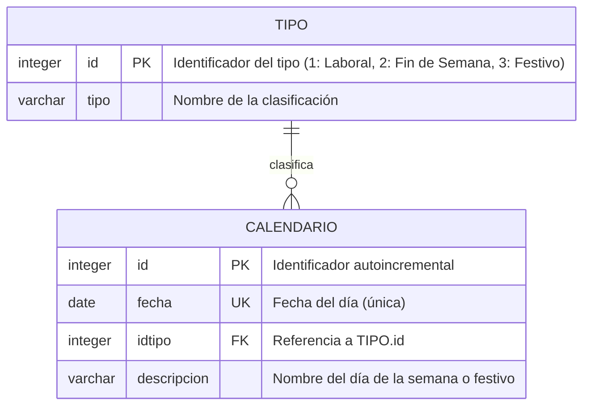
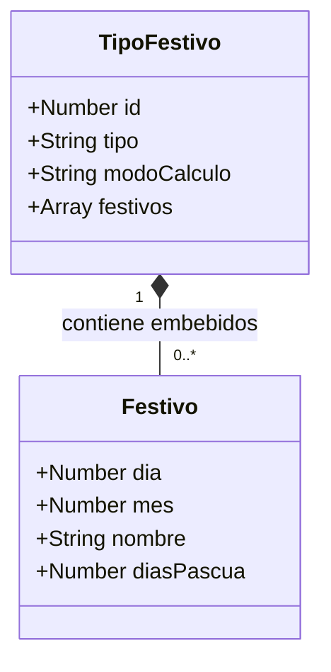
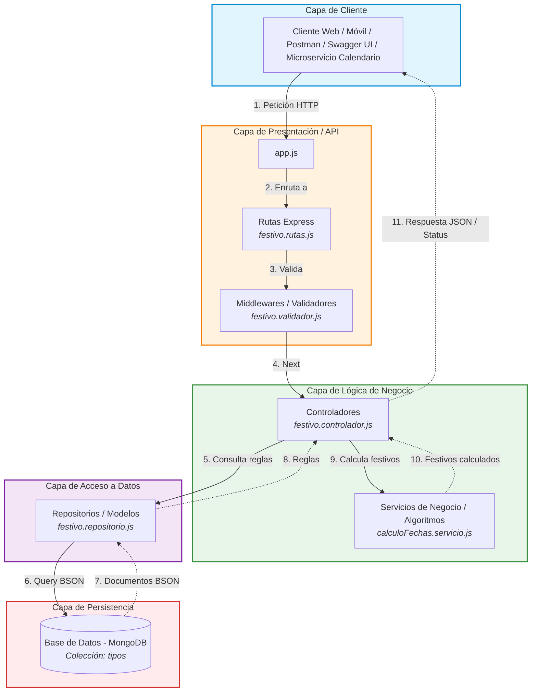

# Arquitectura de Software II - Proyecto Integrador de Microservicios
## Microservicio 1: API Festivos de Colombia (Express.js + MongoDB)
## Microservicio 2: API Calendario Laboral (Spring Boot + PostgreSQL)

> **Institución:** Instituto Tecnológico Metropolitano (ITM)  
> **Docente:** Fray León Osorio Rivera (`frayosorio@gmail.com`)  
> **Asignatura:** Arquitectura de Software II  
> **Repositorio Oficial:** [https://github.com/CamiloO15H/arquitectura-api-festivos](https://github.com/CamiloO15H/arquitectura-api-festivos)  

---

## 👥 Integrantes del Equipo

| # | Nombre Completo | Usuario GitHub |
| :-: | :--- | :--- |
| 1 | **Camilo Ospina Hernández** | [@CamiloO15H](https://github.com/CamiloO15H) |
| 2 | **Luis David Orozco Moreno** | Integrante |

---

# 🏆 TERCER SEGUIMIENTO (20% - ENTREGA ACTUAL): Implementación API Festivos

> **Fecha Límite:** **22 de Octubre de 2026**  
> **Tecnologías:** Node.js + Express.js + MongoDB Atlas + Swagger UI  
> **Estado:** ✅ **100% Funcional y Verificado con Pruebas Automatizadas**  

Esta entrega corresponde a la **implementación de código funcional** del microservicio de Festivos de Colombia. La solución calcula dinámicamente las fechas festivas a partir de las reglas de cálculo almacenadas en una base de datos **MongoDB Atlas**, aplicando el algoritmo astronómico del Domingo de Pascua y los traslados de puente festivo de la **Ley Emiliani (Ley 51 de 1983)**.

---

### 🚀 1. Guía Rápida de Ejecución

```bash
# 1. Clonar el repositorio (si no lo tienes)
git clone https://github.com/CamiloO15H/arquitectura-api-festivos.git
cd arquitectura-api-festivos

# 2. Instalar dependencias
npm install

# 3. Iniciar el servidor Express (conectado a MongoDB Atlas)
npm start
```

La consola confirmará el inicio del servicio:
```text
=======================================================
🚀 API Festivos ejecutándose en: http://localhost:3000
📖 Documentación Swagger UI en: http://localhost:3000/api-docs
=======================================================
```

---

### 📖 2. Documentación Interactiva en Vivo (Swagger UI)

Con el servidor encendido, abre en tu navegador:  
👉 **[http://localhost:3000/api-docs](http://localhost:3000/api-docs)**  

Desde la interfaz gráfica de Swagger puedes probar interactivamente cada endpoint con botones *«Try it out»*.

---

### 🔌 3. Endpoints Disponibles y Respuestas

#### A. Verificar si una fecha es festivo
* **Ruta:** `GET /api/festivos/verificar/:anio/:mes/:dia`
* **Ejemplos:**
  * `GET /api/festivos/verificar/2026/1/1` $\rightarrow$ `200 OK`: `"Es Festivo"` *(Año Nuevo - Fijo)*
  * `GET /api/festivos/verificar/2026/1/12` $\rightarrow$ `200 OK`: `"Es Festivo"` *(Santos Reyes - Trasladado por Ley Emiliani)*
  * `GET /api/festivos/verificar/2026/4/2` $\rightarrow$ `200 OK`: `"Es Festivo"` *(Jueves Santo - Basado en Pascua)*
  * `GET /api/festivos/verificar/2026/6/8` $\rightarrow$ `200 OK`: `"Es Festivo"` *(Corpus Christi - Pascua + Emiliani)*
  * `GET /api/festivos/verificar/2026/1/2` $\rightarrow$ `200 OK`: `"No es festivo"` *(Día laboral ordinario)*
  * `GET /api/festivos/verificar/2026/2/35` $\rightarrow$ `200 OK`: `"Fecha No valida"` *(Descartado por validador)*

#### B. Obtener todos los festivos de un año
* **Ruta:** `GET /api/festivos/obtener/:anio`
* **Propósito:** Endpoint de integración consumido por el Microservicio de Calendario (Spring Boot).
* **Ejemplo:** `GET /api/festivos/obtener/2026`
* **Respuesta:** Array JSON ordenado cronológicamente con fechas calculadas:
  ```json
  [
    { "festivo": "Año Nuevo", "fecha": "2026-01-01" },
    { "festivo": "Santos Reyes", "fecha": "2026-01-12" },
    { "festivo": "San José", "fecha": "2026-03-23" },
    { "festivo": "Jueves Santo", "fecha": "2026-04-02" },
    { "festivo": "Viernes Santo", "fecha": "2026-04-03" },
    { "festivo": "Domingo de Pascua", "fecha": "2026-04-05" },
    { "festivo": "Día del Trabajo", "fecha": "2026-05-01" },
    { "festivo": "Ascensión del Señor", "fecha": "2026-05-18" },
    { "festivo": "Corpus Christi", "fecha": "2026-06-08" },
    { "festivo": "Sagrado Corazón de Jesús", "fecha": "2026-06-15" },
    { "festivo": "San Pedro y San Pablo", "fecha": "2026-06-29" },
    { "festivo": "Día de la Independencia", "fecha": "2026-07-20" },
    { "festivo": "Batalla de Boyacá", "fecha": "2026-08-07" },
    { "festivo": "Asunción de la Virgen", "fecha": "2026-08-17" },
    { "festivo": "Día de la Raza", "fecha": "2026-10-12" },
    { "festivo": "Todos los Santos", "fecha": "2026-11-02" },
    { "festivo": "Independencia de Cartagena", "fecha": "2026-11-16" },
    { "festivo": "Inmaculada Concepción", "fecha": "2026-12-08" },
    { "festivo": "Navidad", "fecha": "2026-12-25" }
  ]
  ```

#### C. Operaciones CRUD (Administración de Festivos en MongoDB)
* `POST /api/festivos/agregar`: Inserta una regla de festivo dentro de un tipo (`$push`).
* `PUT /api/festivos/modificar`: Modifica los datos de un festivo existente (`$set`).
* `DELETE /api/festivos/eliminar/:idTipo/:nombre`: Elimina una regla de festivo (`$pull`).

---

### 🧪 4. Pruebas Automatizadas

```bash
# Probar cálculos matemáticos aislados (2024, 2025, 2026)
npm test

# Probar integración completa contra MongoDB Atlas en vivo
node scripts/test-api.js

# Probar peticiones HTTP reales al servidor
node scripts/test-server.js
```

---

### 📂 5. Estructura del Microservicio

```text
├── app.js                          # Configuración de Express, CORS y servidor
├── configuracion/
│   ├── bd.config.js                # Variables de conexión a MongoDB
│   └── swagger.config.js           # Especificación OpenAPI 3.0 para Swagger
├── controladores/
│   └── festivo.controlador.js      # Lógica de respuestas HTTP
├── modelos/
│   ├── bd.js                       # Cliente de conexión oficial MongoClient
│   └── festivo.repositorio.js      # Consultas y operaciones CRUD ($push, $set, $pull)
├── rutas/
│   └── festivo.rutas.js            # Enrutamiento de endpoints
├── servicios/
│   └── calculoFechas.servicio.js   # Algoritmo de Butcher/Meeus y Ley Emiliani
├── validadores/
│   └── festivo.validador.js        # Middleware de validación de fechas
└── scripts/
    ├── seed.js                     # Poblar colección 'tipos' en MongoDB Atlas
    ├── test-api.js                 # Suite de pruebas automatizadas
    ├── test-fechas.js              # Verificación matemática
    └── test-server.js              # Test HTTP en vivo
```

---

# 📅 SEGUNDO SEGUIMIENTO (20%): Modelado Arquitectónico API Calendario

> **Docente:** Fray León Osorio Rivera  
> **Fecha de Entrega:** 8 de Octubre de 2026  
> **Tecnologías:** Spring Boot + Spring Data JPA + PostgreSQL  
> **Patrón Arquitectónico:** **Arquitectura Cebolla (*Onion Architecture*)**  

Este microservicio cumple el doble rol de **servidor** (expone generación y listado del calendario) y **cliente** de la API de Festivos (`GET /api/festivos/obtener/{anio}` mediante `RestTemplate`), clasificando y persistiendo los 365/366 días de un año en PostgreSQL.

### 📊 Diagrama Relacional de Base de Datos (PostgreSQL)

*Archivo fuente individual:* [`diagrama-relacional-calendario.md`](./diagrama-relacional-calendario.md)



### 🏛️ Diagrama de Arquitectura Cebolla (Onion Architecture)

*Archivo fuente individual:* [`diagrama-arquitectura-calendario.md`](./diagrama-arquitectura-calendario.md)

```mermaid
graph TD
%% Módulo Dominio
    subgraph Dominio [Módulo: dominio]
        Entidades[Calendario / Tipo / Usuario]
        DTOs[FestivoDto / CalendarioDto / UsuarioLoginDto]
    end

%% Módulo Core
    subgraph Core [Módulo: core]
        InterfacesServicio[ICalendarioServicio / ITipoServicio / IUsuarioServicio]
        InterfacesRepo[ICalendarioRepositorio / ITipoRepositorio<br/>IUsuarioRepositorio]
        InterfacesIntegracion[IFestivoServicioExterno]
    end

%% Módulo Aplicación
    subgraph Aplicacion [Módulo: aplicacion]
        ServiciosApp[CalendarioServicio / TipoServicio / UsuarioServicio]
        SeguridadApp[FiltroSeguridad / SeguridadServicio / UsuarioDetalleServicio / UsuarioDetalles]
    end

%% Módulo Infraestructura
    subgraph Infraestructura [Módulo: infraestructura]
        RepositoriosImpl[CalendarioRepositorio / TipoRepositorio<br/>UsuarioRepositorio]
        RepositoriosJPA[ICalendarioRepositorioJpa / ITipoRepositorioJpa<br/>IUsuarioRepositorioJpa]
        EntidadesJPA[CalendarioEntidad / TipoEntidad<br/>UsuarioEntidad]
        Mapeadores[CalendarioMapeador / TipoMapeador<br/>UsuarioMapeador]
        IntegracionExt[FestivoServicioExterno / HttpServicio]
        DB[(Base de Datos: PostgreSQL)]
        APIExterna[API Externa Festivos<br/>Express.js + MongoDB]
    end

%% Módulo Presentación
    subgraph Presentacion [Módulo: presentacion]
        ApiApp[CalendarioApplication @SpringBootApplication]
        Controladores[CalendarioControlador / TipoControlador / UsuarioControlador]
        Configuracion[ConfiguracionSeguridad / SwaggerConfig]
        Handlers[ExcepcionesGlobalesHandler]
        DtosPresentacion[ErrorRespuesta]
    end

%% Relaciones Aplicación -> Core / Dominio
    ServiciosApp -.->|Implementa| InterfacesServicio
    ServiciosApp -->|Inyecta| InterfacesRepo
    ServiciosApp -->|Inyecta| InterfacesIntegracion
    ServiciosApp -->|Maneja| Entidades
    SeguridadApp -->|Inyecta| InterfacesRepo

%% Relaciones Infraestructura -> Core / Dominio
    RepositoriosImpl -.->|Implementa| InterfacesRepo
    RepositoriosImpl -->|Inyecta| RepositoriosJPA
    RepositoriosImpl -->|Usa| Mapeadores

    Mapeadores -->|Transforma| Entidades
    Mapeadores -->|Transforma| EntidadesJPA

    FestivoServicioExterno -.->|Implementa| InterfacesIntegracion
    FestivoServicioExterno -->|RestTemplate / GET| APIExterna

%% Relaciones JPA -> Base de Datos
    RepositoriosJPA -->|Spring Data JPA / SQL| DB
    EntidadesJPA -->|Mapeo ORM @Entity| DB

%% Relaciones Presentación -> Aplicación / Core / Dominio
    Controladores -->|Inyecta| InterfacesServicio
    Controladores -->|Usa| DTOs
    Controladores -->|Usa| Entidades
    Configuracion -->|Usa| SeguridadApp
```



---

# 🚀 PRIMER SEGUIMIENTO (20%): Modelado Arquitectónico API Festivos

> **Docente:** Fray León Osorio Rivera  
> **Fecha de Entrega:** 24 de Septiembre de 2026  
> **Tecnologías:** Node.js + Express.js + MongoDB  
> **Patrón Arquitectónico:** Arquitectura en Capas / MVC  

### 📊 Diagrama 1: Modelo Objetual NoSQL (MongoDB)

*Archivo fuente individual:* [`diagrama-objetual-festivos.md`](./diagrama-objetual-festivos.md)



### 🏛️ Diagrama 2: Arquitectura por Capas del Microservicio

*Archivo fuente individual:* [`diagrama-arquitectura-festivos.md`](./diagrama-arquitectura-festivos.md)


