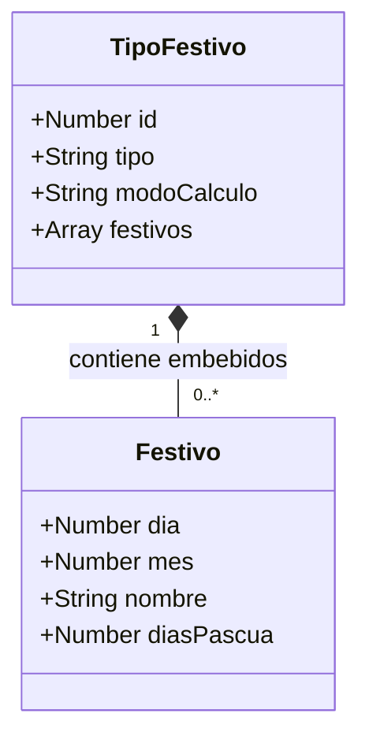
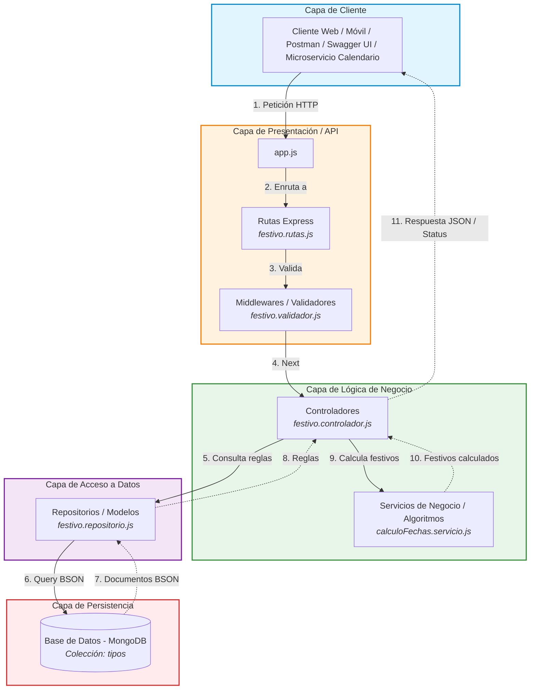

# 🚀 Primer Seguimiento (20%): Modelado Arquitectónico API Festivos

> **Asignatura:** Arquitectura de Software II  
> **Docente:** Fray León Osorio Rivera (`frayosorio@gmail.com`)  
> **Fecha Límite:** **24 de Septiembre de 2026**  
> **Estudiantes:** Camilo Ospina Hernández & Luis David Orozco Moreno  
> **Stack Tecnológico:** Node.js + Express.js + MongoDB  
> **Patrón Arquitectónico:** **Arquitectura en Capas / MVC**  

---

## 📌 Resumen del Modelo

Este entregable corresponde a la fase inicial de diseño arquitectónico y modelado de datos para el microservicio de Festivos de Colombia, sentando las bases para la implementación del Tercer Seguimiento.

---

## 📂 Archivos Fuente Individuales

* [`diagrama-objetual-festivos.md`](../diagrama-objetual-festivos.md) - Modelo Objetual de Base de Datos NoSQL en Mermaid.
* [`diagrama-arquitectura-festivos.md`](../diagrama-arquitectura-festivos.md) - Arquitectura por Capas del Microservicio en Mermaid.

---

## 📊 1. Diagrama Objetual NoSQL (MongoDB)

Para bases de datos de documentos como MongoDB, el estándar de modelado es el **Diagrama de Clases** representando **Colecciones y Subdocumentos Embebidos**. La colección raíz `TipoFestivo` (`tipos`) agrupa mediante composición (`*--`) un conjunto de festivos (`0..*`), eliminando llaves foráneas y uniones costosas.

---

## 🏛️ 2. Diagrama de Arquitectura por Capas

Sigue un patrón horizontal por capas estricto (*Separation of Concerns*):
* **Entrada y Validación:** El middleware `festivo.validador.js` actúa como *Chain of Responsibility* (`next()`) antes del controlador.
* **Lógica de Negocio Desacoplada:** `calculoFechas.servicio.js` aísla el cálculo de la Pascua y los traslados al lunes de la Ley Emiliani (Ley 51 de 1983).
* **Acceso a Datos:** `festivo.repositorio.js` gestiona directamente las colecciones en MongoDB.

