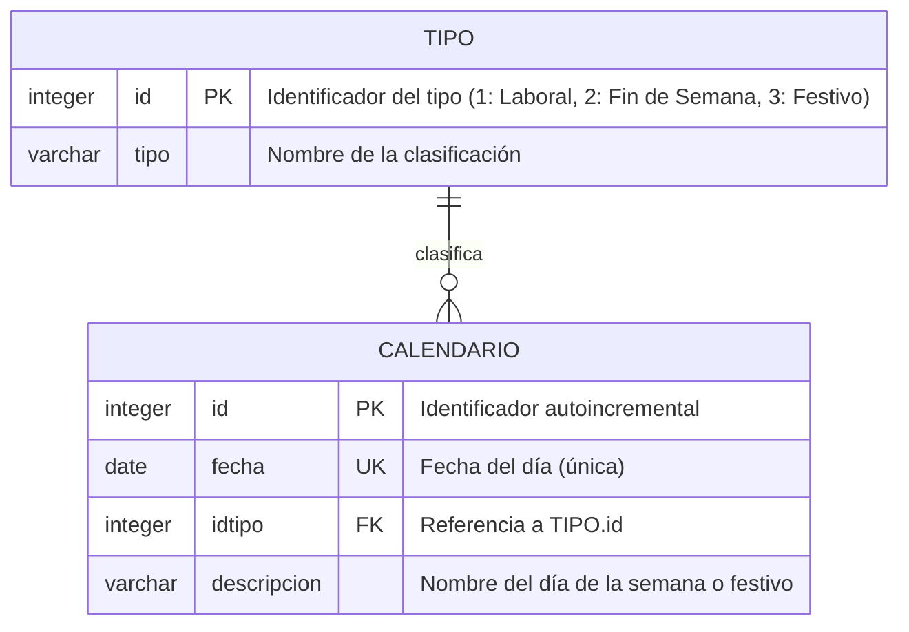

# 📅 Segundo Seguimiento (20%): Modelado Arquitectónico API Calendario

> **Asignatura:** Arquitectura de Software II  
> **Docente:** Fray León Osorio Rivera (`frayosorio@gmail.com`)  
> **Fecha Límite:** **8 de Octubre de 2026**  
> **Estudiantes:** Camilo Ospina Hernández & Luis David Orozco Moreno  
> **Stack Tecnológico:** Java + Spring Boot + Spring Data JPA + PostgreSQL  
> **Patrón Arquitectónico:** **Arquitectura Cebolla (*Onion Architecture*)**  

---

## 📌 Resumen del Modelo

El microservicio de Calendario cumple dos roles esenciales:
1. **Servidor:** Expone los endpoints de generación (`/api/calendario/generar/{anio}`) y listado (`/api/calendario/listar/{anio}`).
2. **Cliente:** Consume el endpoint `GET /api/festivos/obtener/{anio}` de la API de Festivos para clasificar todos los 365/366 días de un año (laboral, fin de semana o festivo) y persistirlos en PostgreSQL.

---

## 📂 Archivos Fuente Individuales

* [`diagrama-arquitectura-calendario.md`](../diagrama-arquitectura-calendario.md) - Arquitectura Cebolla en Mermaid.
* [`diagrama-relacional-calendario.md`](../diagrama-relacional-calendario.md) - Modelo Relacional Entidad-Relación (PostgreSQL).

---

## 📊 1. Diagrama Entidad-Relación (PostgreSQL)

Los datos del calendario tienen un esquema tabular fijo y relaciones referenciales directas, modeladas mediante un **Diagrama Entidad-Relación (ER)**. La tabla `TIPO` clasifica días del `CALENDARIO` mediante la clave foránea `idtipo → tipo.id`.

---

## 🏛️ 2. Diagrama de Arquitectura Cebolla (Onion Architecture)

Implementa el patrón **Arquitectura Cebolla (*Onion Architecture*)** conforme a la cátedra del 1 de octubre de 2026:
* **Módulo Dominio:** Entidades POJO puras de negocio (`Calendario`, `Tipo`, `Usuario`) y DTOs independientes.
* **Módulo Core:** Contratos de servicio (`ICalendarioServicio`), persistencia (`ICalendarioRepositorio`) e integración externa (`IFestivoServicioExterno`).
* **Módulo Aplicación:** Lógica orquestadora en `CalendarioServicio` y seguridad de la aplicación.
* **Módulo Infraestructura:** Implementaciones con `Spring Data JPA`, entidades ORM `@Entity`, mapeadores (`CalendarioMapeador`) y cliente HTTP `FestivoServicioExterno` con `HttpServicio` (`RestTemplate`).
* **Módulo Presentación:** Controladores REST (`CalendarioControlador`), Swagger y manejo de excepciones.

```mermaid
graph TD
%% Módulo Dominio
    subgraph Dominio [Módulo: dominio]
        Entidades[Calendario / Tipo / Usuario]
        DTOs[FestivoDto / CalendarioDto / UsuarioLoginDto]
    end

%% Módulo Core
    subgraph Core [Módulo: core]
        InterfacesServicio[ICalendarioServicio / ITipoServicio / IUsuarioServicio]
        InterfacesRepo[ICalendarioRepositorio / ITipoRepositorio<br/>IUsuarioRepositorio]
        InterfacesIntegracion[IFestivoServicioExterno]
    end

%% Módulo Aplicación
    subgraph Aplicacion [Módulo: aplicacion]
        ServiciosApp[CalendarioServicio / TipoServicio / UsuarioServicio]
        SeguridadApp[FiltroSeguridad / SeguridadServicio / UsuarioDetalleServicio / UsuarioDetalles]
    end

%% Módulo Infraestructura
    subgraph Infraestructura [Módulo: infraestructura]
        RepositoriosImpl[CalendarioRepositorio / TipoRepositorio<br/>UsuarioRepositorio]
        RepositoriosJPA[ICalendarioRepositorioJpa / ITipoRepositorioJpa<br/>IUsuarioRepositorioJpa]
        EntidadesJPA[CalendarioEntidad / TipoEntidad<br/>UsuarioEntidad]
        Mapeadores[CalendarioMapeador / TipoMapeador<br/>UsuarioMapeador]
        IntegracionExt[FestivoServicioExterno / HttpServicio]
        DB[(Base de Datos: PostgreSQL)]
        APIExterna[API Externa Festivos<br/>Express.js + MongoDB]
    end

%% Módulo Presentación
    subgraph Presentacion [Módulo: presentacion]
        ApiApp[CalendarioApplication @SpringBootApplication]
        Controladores[CalendarioControlador / TipoControlador / UsuarioControlador]
        Configuracion[ConfiguracionSeguridad / SwaggerConfig]
        Handlers[ExcepcionesGlobalesHandler]
        DtosPresentacion[ErrorRespuesta]
    end

%% Relaciones Aplicación -> Core / Dominio
    ServiciosApp -.->|Implementa| InterfacesServicio
    ServiciosApp -->|Inyecta| InterfacesRepo
    ServiciosApp -->|Inyecta| InterfacesIntegracion
    ServiciosApp -->|Maneja| Entidades
    SeguridadApp -->|Inyecta| InterfacesRepo

%% Relaciones Infraestructura -> Core / Dominio
    RepositoriosImpl -.->|Implementa| InterfacesRepo
    RepositoriosImpl -->|Inyecta| RepositoriosJPA
    RepositoriosImpl -->|Usa| Mapeadores

    Mapeadores -->|Transforma| Entidades
    Mapeadores -->|Transforma| EntidadesJPA

    FestivoServicioExterno -.->|Implementa| InterfacesIntegracion
    FestivoServicioExterno -->|RestTemplate / GET| APIExterna

%% Relaciones JPA -> Base de Datos
    RepositoriosJPA -->|Spring Data JPA / SQL| DB
    EntidadesJPA -->|Mapeo ORM @Entity| DB

%% Relaciones Presentación -> Aplicación / Core / Dominio
    Controladores -->|Inyecta| InterfacesServicio
    Controladores -->|Usa| DTOs
    Controladores -->|Usa| Entidades
    Configuracion -->|Usa| SeguridadApp
```

---

## 🔌 3. Endpoints de la API Calendario

| Método | Endpoint | Descripción de Negocio | Respuesta Esperada |
| :--- | :--- | :--- | :--- |
| `GET` | `/api/calendario/generar/{anio}` | Consume festivos de la API Express, clasifica los días del año y los persiste en PostgreSQL. | `true` / `false` |
| `GET` | `/api/calendario/listar/{anio}` | Retorna el listado completo de los días del año clasificados con su tipo. | Array JSON de días con tipo anidado |
